# Database schema

Generated from `backend/app/models` by `python -m scripts.gen_schema_doc`. PostgreSQL 16.

All brand-owned tables carry `brand_id`; every service query filters on it.

```mermaid
erDiagram
    import_batches ||--o{ brand_contacts : "source_import_batch_id"
    users ||--o{ brand_contacts : "owner_user_id"
    sender_accounts ||--o{ brand_contacts : "sticky_whatsapp_sender_id"
    sender_accounts ||--o{ brand_contacts : "sticky_email_sender_id"
    sender_accounts ||--o{ brand_contacts : "sticky_sms_sender_id"
    contacts ||--o{ brand_contacts : "contact_id"
    brands ||--o{ brand_contacts : "brand_id"
    contacts ||--o{ contact_consents : "contact_id"
    brands ||--o{ contact_consents : "brand_id"
    brands ||--o{ suppressions : "brand_id"
    import_batches ||--o{ import_batches : "duplicate_of_batch_id"
    brands ||--o{ import_batches : "default_brand_id"
    users ||--o{ import_batches : "uploaded_by"
    contacts ||--o{ import_rows : "contact_id"
    brands ||--o{ import_rows : "brand_id"
    import_batches ||--o{ import_rows : "batch_id"
    outbound_messages ||--o{ import_rows : "outbound_message_id"
    message_templates ||--o{ campaigns : "template_id"
    users ||--o{ campaigns : "approved_by"
    users ||--o{ campaigns : "created_by"
    brands ||--o{ campaigns : "brand_id"
    import_batches ||--o{ campaigns : "source_import_batch_id"
    users ||--o{ conversations : "owner_user_id"
    campaigns ||--o{ conversations : "campaign_id"
    contacts ||--o{ conversations : "contact_id"
    brands ||--o{ conversations : "brand_id"
    sender_accounts ||--o{ conversations : "sender_account_id"
    message_templates ||--o{ outbound_messages : "template_id"
    contacts ||--o{ outbound_messages : "contact_id"
    conversations ||--o{ outbound_messages : "conversation_id"
    campaigns ||--o{ outbound_messages : "campaign_id"
    follow_up_tasks ||--o{ outbound_messages : "follow_up_task_id"
    sender_accounts ||--o{ outbound_messages : "requested_sender_id"
    sender_accounts ||--o{ outbound_messages : "sender_account_id"
    brands ||--o{ outbound_messages : "brand_id"
    sender_accounts ||--o{ message_attempts : "sender_account_id"
    outbound_messages ||--o{ message_attempts : "outbound_message_id"
    brands ||--o{ inbound_messages : "brand_id"
    sender_accounts ||--o{ inbound_messages : "sender_account_id"
    contacts ||--o{ inbound_messages : "contact_id"
    campaigns ||--o{ inbound_messages : "campaign_id"
    conversations ||--o{ inbound_messages : "conversation_id"
    sender_accounts ||--o{ master_report_settings : "notification_email_sender_id"
    sender_accounts ||--o{ master_report_settings : "notification_sms_sender_id"
    sender_accounts ||--o{ master_report_settings : "notification_whatsapp_sender_id"
    master_reports ||--o{ notification_deliveries : "report_id"
    brands ||--o{ sender_accounts : "brand_id"
    sender_accounts ||--o{ sender_routing_state : "last_sender_id"
    brands ||--o{ sender_routing_state : "brand_id"
    sender_accounts ||--o{ sender_assignments : "sender_account_id"
    outbound_messages ||--o{ sender_assignments : "outbound_message_id"
    brands ||--o{ sender_assignments : "brand_id"
    sender_accounts ||--o{ sender_credentials : "sender_account_id"
    sender_accounts ||--o{ auth_challenges : "sender_account_id"
    users ||--o{ auth_challenges : "user_id"
    users ||--o{ brand_memberships : "user_id"
    brands ||--o{ brand_memberships : "brand_id"
    users ||--o{ audit_logs : "user_id"
    brands ||--o{ audit_logs : "brand_id"
    brands ||--o{ message_templates : "brand_id"
    campaigns ||--o{ follow_up_rules : "campaign_id"
    users ||--o{ follow_up_rules : "default_assignee_id"
    brands ||--o{ follow_up_rules : "brand_id"
    brands ||--o{ follow_up_tasks : "brand_id"
    contacts ||--o{ follow_up_tasks : "contact_id"
    campaigns ||--o{ follow_up_tasks : "campaign_id"
    message_templates ||--o{ follow_up_tasks : "template_id"
    users ||--o{ follow_up_tasks : "assigned_user_id"
    conversations ||--o{ follow_up_tasks : "conversation_id"
    follow_up_rules ||--o{ follow_up_tasks : "rule_id"
    contacts ||--o{ daily_tasks : "contact_id"
    conversations ||--o{ daily_tasks : "conversation_id"
    follow_up_tasks ||--o{ daily_tasks : "follow_up_task_id"
    daily_tasks ||--o{ daily_tasks : "carried_from_id"
    users ||--o{ daily_tasks : "assigned_user_id"
    users ||--o{ daily_tasks : "created_by"
    users ||--o{ daily_tasks : "completed_by"
    brands ||--o{ daily_tasks : "brand_id"
```

## Tenancy & access

### `brands`

| Column | Type | Null | Notes |
|---|---|---|---|
| id | integer | no | PK |
| slug | varchar(64) | no | unique |
| name | varchar(160) | no |  |
| status | varchar(20) | no |  |
| timezone | varchar(64) | no |  |
| primary_color | varchar(16) | yes |  |
| master_email | varchar(255) | yes |  |
| settings | jsonb | no |  |
| created_at | datetime | no |  |
| updated_at | datetime | no |  |

### `users`

| Column | Type | Null | Notes |
|---|---|---|---|
| id | integer | no | PK |
| email | varchar(255) | no | unique |
| full_name | varchar(160) | no |  |
| phone | varchar(32) | yes |  |
| password_hash | varchar(255) | no |  |
| is_super_admin | boolean | no |  |
| is_active | boolean | no |  |
| last_login_at | datetime | yes |  |
| google_sub | varchar(64) | yes | unique |
| mfa_email_enabled | boolean | no |  |
| created_at | datetime | no |  |
| updated_at | datetime | no |  |

### `brand_memberships`

| Column | Type | Null | Notes |
|---|---|---|---|
| id | integer | no | PK |
| user_id | integer | no | FK → users.id, indexed |
| brand_id | integer | no | FK → brands.id, indexed |
| role | varchar(20) | no |  |
| created_at | datetime | no |  |
| updated_at | datetime | no |  |

Unique: (user_id, brand_id)

### `audit_logs`

| Column | Type | Null | Notes |
|---|---|---|---|
| id | integer | no | PK |
| brand_id | integer | yes | FK → brands.id, indexed |
| user_id | integer | yes | FK → users.id |
| action | varchar(80) | no | indexed |
| entity_type | varchar(60) | yes |  |
| entity_id | varchar(60) | yes |  |
| details | jsonb | no |  |
| ip_address | varchar(64) | yes |  |
| created_at | datetime | no | indexed |

### `message_templates`

| Column | Type | Null | Notes |
|---|---|---|---|
| id | integer | no | PK |
| brand_id | integer | no | FK → brands.id, indexed |
| channel | varchar(16) | no |  |
| name | varchar(120) | no |  |
| purpose | varchar(30) | no |  |
| subject | varchar(300) | yes |  |
| body | text | no |  |
| language | varchar(10) | no |  |
| external_template_id | varchar(120) | yes |  |
| approval_status | varchar(20) | no |  |
| variables | jsonb | no |  |
| created_at | datetime | no |  |
| updated_at | datetime | no |  |

Unique: (brand_id, channel, name)

## Senders & routing

### `sender_accounts`

| Column | Type | Null | Notes |
|---|---|---|---|
| id | integer | no | PK |
| brand_id | integer | no | FK → brands.id, indexed |
| channel | varchar(16) | no |  |
| provider | varchar(30) | no |  |
| address | varchar(255) | no |  |
| display_name | varchar(160) | yes |  |
| status | varchar(20) | no |  |
| connection_status | varchar(20) | no |  |
| paused_reason | varchar(255) | yes |  |
| rotation_order | integer | no |  |
| is_notification_sender | boolean | no |  |
| is_master | boolean | no |  |
| verified_at | datetime | yes |  |
| verified_via | varchar(20) | yes |  |
| daily_limit | integer | no |  |
| hourly_limit | integer | no |  |
| provider_daily_limit | integer | yes |  |
| usage_date | date | yes |  |
| sent_today | integer | no |  |
| usage_hour | datetime | yes |  |
| sent_this_hour | integer | no |  |
| secret_ref | varchar(400) | yes |  |
| provider_config | jsonb | no |  |
| health_status | varchar(20) | no |  |
| last_health_check_at | datetime | yes |  |
| last_error | text | yes |  |
| bounce_count_7d | integer | no |  |
| created_at | datetime | no |  |
| updated_at | datetime | no |  |

Unique: (brand_id, channel, address)

### `sender_routing_state`

| Column | Type | Null | Notes |
|---|---|---|---|
| id | integer | no | PK |
| brand_id | integer | no | FK → brands.id |
| channel | varchar(16) | no |  |
| last_sender_id | integer | yes | FK → sender_accounts.id |
| assignments_total | integer | no |  |
| updated_at | datetime | no |  |

Unique: (brand_id, channel)

### `sender_assignments`

| Column | Type | Null | Notes |
|---|---|---|---|
| id | integer | no | PK |
| brand_id | integer | no | FK → brands.id, indexed |
| outbound_message_id | integer | yes | FK → outbound_messages.id, indexed |
| channel | varchar(16) | no |  |
| routing_mode | varchar(10) | no |  |
| sender_account_id | integer | yes | FK → sender_accounts.id |
| outcome | varchar(20) | no |  |
| reason | varchar(255) | yes |  |
| created_at | datetime | no | indexed |

## Contacts & consent

### `contacts`

| Column | Type | Null | Notes |
|---|---|---|---|
| id | integer | no | PK |
| email | varchar(255) | yes | indexed |
| phone | varchar(32) | yes | indexed |
| created_at | datetime | no |  |
| updated_at | datetime | no |  |

### `brand_contacts`

| Column | Type | Null | Notes |
|---|---|---|---|
| id | integer | no | PK |
| brand_id | integer | no | FK → brands.id, indexed |
| contact_id | integer | no | FK → contacts.id, indexed |
| contact_name | varchar(200) | yes |  |
| company_name | varchar(200) | yes |  |
| email | varchar(255) | yes |  |
| phone | varchar(32) | yes |  |
| owner_user_id | integer | yes | FK → users.id |
| tags | jsonb | no |  |
| notes | text | yes |  |
| status | varchar(20) | no |  |
| sticky_email_sender_id | integer | yes | FK → sender_accounts.id |
| sticky_whatsapp_sender_id | integer | yes | FK → sender_accounts.id |
| sticky_sms_sender_id | integer | yes | FK → sender_accounts.id |
| source_import_batch_id | integer | yes | FK → import_batches.id |
| created_at | datetime | no |  |
| updated_at | datetime | no |  |

Unique: (brand_id, contact_id)

### `contact_consents`

| Column | Type | Null | Notes |
|---|---|---|---|
| id | integer | no | PK |
| brand_id | integer | no | FK → brands.id, indexed |
| contact_id | integer | no | FK → contacts.id, indexed |
| channel | varchar(16) | no |  |
| status | varchar(20) | no |  |
| source | varchar(200) | yes |  |
| captured_at | datetime | yes |  |
| withdrawn_at | datetime | yes |  |
| updated_at | datetime | no |  |

Unique: (brand_id, contact_id, channel)

### `suppressions`

| Column | Type | Null | Notes |
|---|---|---|---|
| id | integer | no | PK |
| brand_id | integer | no | FK → brands.id, indexed |
| channel | varchar(16) | no |  |
| address | varchar(255) | no |  |
| reason | varchar(40) | no |  |
| created_at | datetime | no |  |

Unique: (brand_id, channel, address)

## Import

### `import_batches`

| Column | Type | Null | Notes |
|---|---|---|---|
| id | integer | no | PK |
| uploaded_by | integer | yes | FK → users.id |
| default_brand_id | integer | yes | FK → brands.id |
| filename | varchar(255) | no |  |
| file_hash | varchar(64) | no | indexed |
| storage_path | varchar(500) | no |  |
| file_data | blob | yes |  |
| status | varchar(20) | no |  |
| duplicate_of_batch_id | integer | yes | FK → import_batches.id |
| sheets | jsonb | no |  |
| selected_sheets | jsonb | no |  |
| mapping | jsonb | no |  |
| options | jsonb | no |  |
| counts | jsonb | no |  |
| committed_at | datetime | yes |  |
| created_at | datetime | no |  |
| updated_at | datetime | no |  |

### `import_rows`

| Column | Type | Null | Notes |
|---|---|---|---|
| id | integer | no | PK |
| batch_id | integer | no | FK → import_batches.id, indexed |
| sheet_name | varchar(120) | no |  |
| row_number | integer | no |  |
| brand_id | integer | yes | FK → brands.id |
| raw | jsonb | no |  |
| normalized | jsonb | no |  |
| status | varchar(20) | no |  |
| errors | jsonb | no |  |
| idempotency_key | varchar(64) | yes | indexed |
| contact_id | integer | yes | FK → contacts.id |
| outbound_message_id | integer | yes | FK → outbound_messages.id |

## Messaging

### `campaigns`

| Column | Type | Null | Notes |
|---|---|---|---|
| id | integer | no | PK |
| brand_id | integer | no | FK → brands.id, indexed |
| name | varchar(200) | no |  |
| channel | varchar(16) | no |  |
| kind | varchar(10) | no |  |
| status | varchar(20) | no |  |
| subject | varchar(300) | yes |  |
| body | text | yes |  |
| template_id | integer | yes | FK → message_templates.id |
| default_routing_mode | varchar(10) | no |  |
| allowed_sender_ids | jsonb | no |  |
| segment | jsonb | no |  |
| scheduled_at | datetime | yes |  |
| created_by | integer | yes | FK → users.id |
| approved_by | integer | yes | FK → users.id |
| approved_at | datetime | yes |  |
| stopped_reason | varchar(255) | yes |  |
| source_import_batch_id | integer | yes | FK → import_batches.id |
| created_at | datetime | no |  |
| updated_at | datetime | no |  |

Unique: (brand_id, name)

### `outbound_messages`

| Column | Type | Null | Notes |
|---|---|---|---|
| id | integer | no | PK |
| brand_id | integer | no | FK → brands.id, indexed |
| campaign_id | integer | yes | FK → campaigns.id, indexed |
| contact_id | integer | no | FK → contacts.id, indexed |
| conversation_id | integer | yes | FK → conversations.id |
| follow_up_task_id | integer | yes | FK → follow_up_tasks.id |
| channel | varchar(16) | no |  |
| to_address | varchar(255) | no |  |
| subject | varchar(300) | yes |  |
| body | text | yes |  |
| template_id | integer | yes | FK → message_templates.id |
| template_params | jsonb | no |  |
| routing_mode | varchar(10) | no |  |
| requested_sender_id | integer | yes | FK → sender_accounts.id |
| sender_account_id | integer | yes | FK → sender_accounts.id |
| status | varchar(20) | no |  |
| hold_reason | varchar(255) | yes |  |
| idempotency_key | varchar(80) | no | unique |
| scheduled_at | datetime | yes |  |
| sending_started_at | datetime | yes |  |
| sent_at | datetime | yes |  |
| delivered_at | datetime | yes |  |
| provider_message_id | varchar(255) | yes | indexed |
| provider_thread_id | varchar(255) | yes |  |
| attempt_count | integer | no |  |
| last_error | text | yes |  |
| import_row_ref | varchar(80) | yes |  |
| created_at | datetime | no |  |
| updated_at | datetime | no |  |

### `message_attempts`

| Column | Type | Null | Notes |
|---|---|---|---|
| id | integer | no | PK |
| outbound_message_id | integer | no | FK → outbound_messages.id, indexed |
| sender_account_id | integer | yes | FK → sender_accounts.id |
| attempt_no | integer | no |  |
| status | varchar(20) | no |  |
| provider_message_id | varchar(255) | yes |  |
| error | text | yes |  |
| meta | jsonb | no |  |
| created_at | datetime | no |  |

### `conversations`

| Column | Type | Null | Notes |
|---|---|---|---|
| id | integer | no | PK |
| brand_id | integer | no | FK → brands.id, indexed |
| contact_id | integer | no | FK → contacts.id |
| channel | varchar(16) | no |  |
| sender_account_id | integer | yes | FK → sender_accounts.id |
| campaign_id | integer | yes | FK → campaigns.id |
| external_thread_id | varchar(255) | yes | indexed |
| last_message_ref | varchar(500) | yes |  |
| subject | varchar(300) | yes |  |
| status | varchar(20) | no |  |
| owner_user_id | integer | yes | FK → users.id |
| followups_paused | boolean | no |  |
| last_outbound_at | datetime | yes |  |
| last_inbound_at | datetime | yes |  |
| unread_count | integer | no |  |
| created_at | datetime | no |  |
| updated_at | datetime | no |  |

### `inbound_messages`

| Column | Type | Null | Notes |
|---|---|---|---|
| id | integer | no | PK |
| brand_id | integer | no | FK → brands.id, indexed |
| conversation_id | integer | yes | FK → conversations.id, indexed |
| contact_id | integer | yes | FK → contacts.id |
| sender_account_id | integer | no | FK → sender_accounts.id |
| campaign_id | integer | yes | FK → campaigns.id |
| channel | varchar(16) | no |  |
| from_address | varchar(255) | no |  |
| subject | varchar(300) | yes |  |
| body | text | yes |  |
| provider_message_id | varchar(255) | no |  |
| provider_thread_id | varchar(255) | yes |  |
| in_reply_to | varchar(500) | yes |  |
| received_at | datetime | no | indexed |
| is_unsubscribe | boolean | no |  |
| classification | varchar(40) | yes |  |
| classification_source | varchar(10) | yes |  |
| classification_confidence | float | yes |  |
| handled | boolean | no |  |
| raw | jsonb | no |  |

Unique: (channel, provider_message_id)

## Follow-ups & tasks

### `follow_up_rules`

| Column | Type | Null | Notes |
|---|---|---|---|
| id | integer | no | PK |
| brand_id | integer | no | FK → brands.id, indexed |
| campaign_id | integer | yes | FK → campaigns.id, indexed |
| name | varchar(160) | no |  |
| steps | jsonb | no |  |
| max_attempts | integer | no |  |
| stop_on_reply | boolean | no |  |
| default_assignee_id | integer | yes | FK → users.id |
| active | boolean | no |  |
| created_at | datetime | no |  |
| updated_at | datetime | no |  |

### `follow_up_tasks`

| Column | Type | Null | Notes |
|---|---|---|---|
| id | integer | no | PK |
| brand_id | integer | no | FK → brands.id, indexed |
| rule_id | integer | yes | FK → follow_up_rules.id |
| conversation_id | integer | yes | FK → conversations.id, indexed |
| contact_id | integer | no | FK → contacts.id |
| campaign_id | integer | yes | FK → campaigns.id |
| step_index | integer | no |  |
| mode | varchar(20) | no |  |
| template_id | integer | yes | FK → message_templates.id |
| due_at | datetime | no | indexed |
| status | varchar(20) | no |  |
| assigned_user_id | integer | yes | FK → users.id |
| cancel_reason | varchar(120) | yes |  |
| completed_at | datetime | yes |  |
| notes | text | yes |  |
| created_at | datetime | no |  |
| updated_at | datetime | no |  |

Unique: (conversation_id, rule_id, step_index)

### `daily_tasks`

| Column | Type | Null | Notes |
|---|---|---|---|
| id | integer | no | PK |
| brand_id | integer | no | FK → brands.id, indexed |
| contact_id | integer | yes | FK → contacts.id |
| company_name | varchar(200) | yes |  |
| assigned_user_id | integer | yes | FK → users.id, indexed |
| description | text | no |  |
| priority | varchar(10) | no |  |
| due_at | datetime | yes | indexed |
| status | varchar(20) | no | indexed |
| completed_at | datetime | yes |  |
| completed_by | integer | yes | FK → users.id |
| completed_source | varchar(10) | yes |  |
| notes | text | yes |  |
| conversation_id | integer | yes | FK → conversations.id |
| follow_up_task_id | integer | yes | FK → follow_up_tasks.id |
| source | varchar(20) | no |  |
| carried_from_id | integer | yes | FK → daily_tasks.id |
| carry_count | integer | no |  |
| created_by | integer | yes | FK → users.id |
| created_at | datetime | no |  |
| updated_at | datetime | no |  |

## Master reporting

### `master_report_settings`

| Column | Type | Null | Notes |
|---|---|---|---|
| id | integer | no | PK |
| master_email | varchar(255) | yes |  |
| master_mobile | varchar(32) | yes |  |
| mobile_opt_in_at | datetime | yes |  |
| notification_channel | varchar(30) | no |  |
| morning_time | varchar(5) | no |  |
| evening_time | varchar(5) | no |  |
| timezone | varchar(64) | no |  |
| working_days | jsonb | no |  |
| brand_preferences | jsonb | no |  |
| emergency_alerts_enabled | boolean | no |  |
| report_recipients | jsonb | no |  |
| attach_spreadsheet | boolean | no |  |
| notification_email_sender_id | integer | yes | FK → sender_accounts.id |
| notification_whatsapp_sender_id | integer | yes | FK → sender_accounts.id |
| notification_sms_sender_id | integer | yes | FK → sender_accounts.id |
| whatsapp_report_template | varchar(120) | yes |  |
| task_carry_forward | boolean | no |  |
| created_at | datetime | no |  |
| updated_at | datetime | no |  |

### `master_reports`

| Column | Type | Null | Notes |
|---|---|---|---|
| id | integer | no | PK |
| kind | varchar(10) | no |  |
| report_date | date | no |  |
| status | varchar(20) | no |  |
| data | jsonb | no |  |
| html | text | yes |  |
| mobile_text | text | yes |  |
| generated_at | datetime | no |  |

Unique: (kind, report_date)

### `notification_deliveries`

| Column | Type | Null | Notes |
|---|---|---|---|
| id | integer | no | PK |
| report_id | integer | yes | FK → master_reports.id, indexed |
| kind | varchar(20) | no |  |
| channel | varchar(16) | no |  |
| recipient | varchar(255) | no |  |
| status | varchar(20) | no |  |
| attempts | integer | no |  |
| max_attempts | integer | no |  |
| last_error | text | yes |  |
| next_attempt_at | datetime | yes |  |
| sent_at | datetime | yes |  |
| provider_message_id | varchar(255) | yes |  |
| idempotency_key | varchar(120) | no | unique |
| payload | jsonb | no |  |
| created_at | datetime | no |  |
